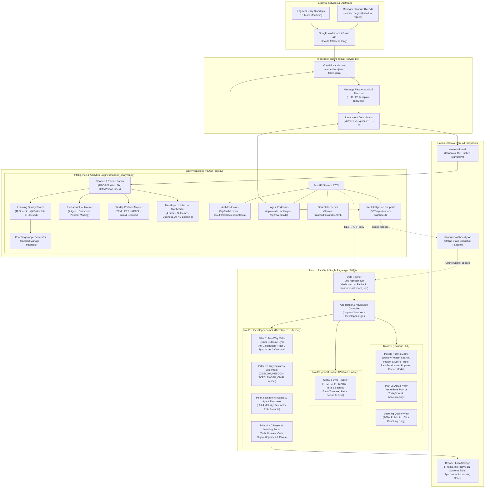
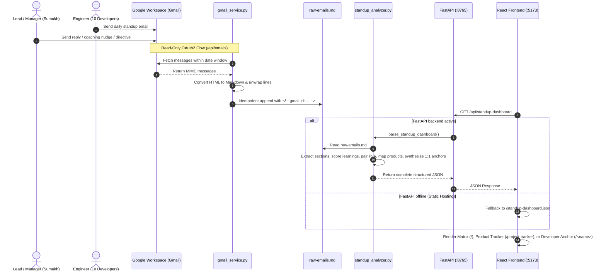

# `agent.md` — Architecture & Extension Guide for AI Agents

This document is the authoritative blueprint for AI coding agents and developers extending the **NSoft AI Standup Intelligence Hub & Product Tracker** (`standup-dashboard`).

---

## 1. System Architecture & Component Diagram

### System Architecture Diagram


### End-to-End Data Pipeline & Sequence


---

## 2. Repository Architecture & Directory Layout

```text
standup-dashboard/
├── raw-emails.md                # Canonical source of truth: ingested Gmail messages in Markdown
├── gmail_service.py             # Gmail OAuth2 client, MIME->Markdown converter, deduplicating writer
├── standup_analyzer.py          # Parser & intelligence engine: raw-emails.md -> structured JSON
├── app.py                       # FastAPI server (:8765) serving REST APIs + SPA routes
├── requirements.txt             # Python backend dependencies
├── start.sh                     # Convenience startup script for backend
└── frontend/                    # React 19 + Vite 6 + Tailwind v4 + Lucide Icons SPA (:5173)
    ├── vite.config.js           # Proxies /api and /oauth2callback to http://127.0.0.1:8765
    ├── public/
    │   └── standup-dashboard.json # Static snapshot fallback for zero-backend / cloud deployments
    └── src/
        ├── main.jsx             # React root entry
        ├── index.css            # Light/Dark CSS custom properties & scrollbar styling
        ├── App.jsx              # Route controller (/ vs /project-tracker), Matrix, Plan-vs-Actual, Learning Scorer
        └── ProductTrackerView.jsx # ClickUp-style Product & Task Tracker (TRM, ERP, KPTCL, Infra & Security)
```

### Data Flow
1. **Ingestion (`gmail_service.py` → `raw-emails.md`)**:
   - Connects to Gmail using read-only OAuth2 (`https://www.googleapis.com/auth/gmail.readonly`).
   - Fetches messages within a selected date window (`after:YYYY/MM/DD before:YYYY/MM/DD`).
   - Extracts `text/plain` or converts `text/html` via `html2text`, and appends selected messages to `raw-emails.md`.
   - Every email block is prefixed with `<!-- gmail-id: <id> -->` so `get_ingested_message_ids()` guarantees idempotent, duplicate-free ingestion.
2. **Analysis (`standup_analyzer.py` → `/api/standup-dashboard`)**:
   - Reads `raw-emails.md`, separates team standup reports from manager replies (`sumukh.hegde@nsoft.in`) and non-standup threads.
   - Unwraps RFC-822 72-character hard line wraps and extracts structured sections: `work_done`, `plan_tomorrow`, `learnings`, and `projects`.
   - Scores learning quality (`green` = specific technical insight, `amber` = repeated generic boilerplate, `red` = missing section or tooling blocker) and attaches tailored coaching nudges.
   - Computes consecutive-day `plan_vs_actual` pairs (`aligned`, `carryover`, `pivoted`, `missing`).
   - Maps workstreams into the 4 NSoft Product Spaces (`TRM`, `ERP`, `KPTCL`, `Infra & Security`) for `/project-tracker`.
3. **Dual-Mode Frontend Consumption (`frontend/src/App.jsx`)**:
   - On load, `fetchDashboard()` calls `GET /api/standup-dashboard` (live parse of `raw-emails.md` when FastAPI is running).
   - If the Python backend is not running (e.g., frontend-only local dev or static hosting on Vercel/Netlify), it automatically falls back to `GET /standup-dashboard.json` in `frontend/public/standup-dashboard.json`.

---

## 2. How to Build and Run All Components

### Mode A: Frontend Only (No Python or Gmail Credentials Required)
Use this mode on any machine when viewing or styling the UI against the committed snapshot:
```bash
cd frontend
npm install
npm run dev
```
- **Standup Intelligence Hub:** `http://localhost:5173/`
- **Product & Task Tracker:** `http://localhost:5173/project-tracker`

### Mode B: Full-Stack Live Mode (FastAPI Backend + React Vite Dev Server)
Use this mode when ingesting new emails from Gmail, modifying `raw-emails.md`, or editing `standup_analyzer.py`:

**Terminal 1 — Start FastAPI Backend (`:8765`):**
```bash
python3 -m venv .venv
./.venv/bin/pip install -r requirements.txt
./.venv/bin/uvicorn app:app --host 127.0.0.1 --port 8765 --reload
```

**Terminal 2 — Start React + Vite Frontend (`:5173`):**
```bash
cd frontend
npm install
npm run dev
```
*(Vite proxies all `/api/*` and `/oauth2callback` requests to `http://127.0.0.1:8765`.)*

### Mode C: Updating the Static Snapshot (`standup-dashboard.json`) & Production Build
Whenever `raw-emails.md` or `standup_analyzer.py` is updated, regenerate the static JSON fallback so standalone frontend users get the latest data:
```bash
./.venv/bin/python -c "
import json
from standup_analyzer import parse_standup_dashboard
with open('frontend/public/standup-dashboard.json', 'w', encoding='utf-8') as f:
    json.dump(parse_standup_dashboard(), f, ensure_ascii=False, indent=2)
"
cd frontend && npm run build
```

---

## 3. Backend Email Ingestion API Reference (`app.py` & `gmail_service.py`)

### Google Cloud OAuth2 Setup
- `gmail_service.py` uses a **fixed redirect URI** handled directly by FastAPI:
  ```text
  http://localhost:8765/oauth2callback
  ```
- In [Google Cloud Console → Credentials](https://console.cloud.google.com/apis/credentials), the OAuth 2.0 Client ID (`Web application` or `Desktop`) must have `http://localhost:8765/oauth2callback` listed under **Authorized redirect URIs**.
- `credentials.json` and `token.json` are stored in the repo root and excluded via `.gitignore`.

### Ingestion Endpoints in `app.py`
| Method & Path | Purpose | Payload / Query Params |
| :--- | :--- | :--- |
| `GET /api/status` | Returns `{ has_credentials, authenticated, email_address, redirect_uri, raw_emails_path }` | None |
| `POST /api/credentials/upload` | Multipart file upload to save `credentials.json` | `file: UploadFile` |
| `POST /api/credentials/paste` | Saves pasted JSON content to `credentials.json` | `{ "json_content": "{...}" }` |
| `POST /api/auth/connect` | Generates Google OAuth2 authorization URL with PKCE verifier | Returns `{ "auth_url": "https://accounts.google.com/..." }` |
| `GET /oauth2callback` | Exchanges Google `code` for `token.json` and redirects to `/` | Handled automatically on redirect |
| `POST /api/auth/disconnect` | Deletes local `token.json` | None |
| `GET /api/emails` | Fetches Gmail messages for date range + marks `ingested: true/false` | `?start_date=YYYY-MM-DD&end_date=YYYY-MM-DD&q=...` |
| `POST /api/ingest` | Appends selected Gmail message IDs into `raw-emails.md` | `{ "message_ids": ["..."], "skip_duplicates": true }` |
| `GET /api/raw-emails` | Returns raw markdown content & byte size of `raw-emails.md` | None |

---

## 4. How to Build a Dedicated `/settings` (or `/ingest`) Page for Email Ingestion

Currently, the app routes between `/` (Standup Hub) and `/project-tracker` (Product Tracker). To add a dedicated `/settings` page for Gmail OAuth configuration and email ingestion:

1. **Add the Route in `app.py`:**
   Decorate `serve_index()` in `app.py` so refreshing `/settings` serves the SPA:
   ```python
   @app.get("/")
   @app.get("/project-tracker")
   @app.get("/settings")
   def serve_index():
       ...
   ```

2. **Add Route State in `frontend/src/App.jsx`:**
   - Extend `currentRoute` detection in `App.jsx` to support `'/' | '/project-tracker' | '/settings'`.
   - Add a `Settings / Ingest` button in the top header bar next to `Standup Hub` and `/project-tracker`.

3. **Wire the Settings Page Components:**
   - **Section A — Gmail Connection Card:**
     - Call `GET /api/status` on mount.
     - Show connection badge (`Connected as <email>` vs `Not Connected`).
     - Provide file upload (`POST /api/credentials/upload`) and JSON textarea paste (`POST /api/credentials/paste`) for `credentials.json`.
     - Display the copyable redirect URI `http://localhost:8765/oauth2callback`.
     - Wire the **Authenticate with Google** button to call `POST /api/auth/connect` and set `window.location.href = data.auth_url`.
   - **Section B — 5-Day Email Selector & Ingestor:**
     - Reuse or expand `GmailIngestView` (already present at the bottom of `frontend/src/App.jsx`) with Start Date (default `today - 5 days`), End Date (`today`), and optional Gmail query filter (e.g., `"Daily Work"` or `"from:nsoft.in"`).
     - Render checkboxes for fetched emails with a badge (`✓ Already in raw-emails.md` when `email.ingested === true`).
     - On clicking **Ingest Selected**, call `POST /api/ingest`, then automatically call `fetchDashboard()` so the Matrix and Project Tracker update immediately.
   - **Section C — Auto-Sync Static Snapshot on Ingest (Recommended):**
     - In `app.py`'s `POST /api/ingest` endpoint, right after `ingest_emails_to_markdown(...)` succeeds, write the updated `parse_standup_dashboard()` output to `frontend/public/standup-dashboard.json`:
       ```python
       result = ingest_emails_to_markdown(req.message_ids, req.skip_duplicates)
       dashboard_data = parse_standup_dashboard()
       (FRONTEND_PUBLIC_DIR / "standup-dashboard.json").write_text(
           json.dumps(dashboard_data, ensure_ascii=False, indent=2),
           encoding="utf-8",
       )
       return result
       ```

---

## 5. How to Make All Pages 100% Dynamic as New Raw Emails Are Ingested

### What Is Already Dynamic Today
When new emails are appended to `raw-emails.md`:
- **Days (`days` array):** `parse_standup_dashboard()` in `standup_analyzer.py` dynamically extracts every unique `YYYY-MM-DD` date from all standup reports (`days_set.add(day_key)`). New columns appear automatically in the **People × Days Matrix**.
- **Matrix Cells (`matrix[email][day]`):** `_extract_sections()`, `_detect_projects()`, `_score_learning()`, and `_generate_gist_and_analysis()` run dynamically on every ingested email block.
- **Plan-vs-Actual (`plan_vs_actual`):** Loops dynamically over all consecutive day pairs `range(len(sorted_days) - 1)`. When a 4th or 5th day is ingested, new transition filters (e.g., `2026-10-31 Plan → 2026-11-02 Actual`) are created automatically.
- **Learning Quality Scorer:** Dynamically aggregates all cells across all days in `matrix`.

### How to Make `/project-tracker` (`_build_product_tracker`) Fully Dynamic
Currently, `_build_product_tracker(matrix, sorted_days)` in `standup_analyzer.py` has a curated baseline of 17 workstreams for the Oct 29 – Nov 1 dataset. To make `/project-tracker` update dynamically as future days of emails are ingested, evolve `_build_product_tracker()` in one of two ways:

#### Approach 1: Deterministic Rule-Based Task Aggregation (Fast, Zero API Cost)
In `_build_product_tracker(matrix, sorted_days)`:
1. **Dynamic Timeline Columns (`timeline_days`):**
   Set `timeline_days` to `sorted_days + [next_working_day]` instead of a hardcoded list.
2. **Map Detected Project Tags to the 4 Product Spaces:**
   Create a deterministic lookup table mapping project tags from `_detect_projects()` to `(product_id, sub_project_name)`:
   - `INESH Meter`, `CMRL`, `Smart Metering`, `EMudra` → `("TRM", "Smart Metering (INESH / CMRL / EMudra)")`
   - `HESCOM`, `Seva Sindhu` → `("TRM", "HESCOM SpotBilling & Integrations")`
   - `BWSSB`, `TRM SpotBilling` → `("TRM", "BWSSB SpotBilling")`
   - `TCED` (when work mentions *Bill Generation, Demand, Wheeling, Complaint, Capacitor, Load*) → `("TRM", "TCED Billing & Demand")`
   - `GESCOM` → `("ERP", "GESCOM ERP & Employee Portal (HRMS)")`
   - `HRMS`, `TCED` (when work mentions *Form 3, Form 4, Employee Creation, Approval, Exit, PF*) → `("ERP", "TCED ERP & Employee Portal (HRMS & PF)")`
   - `BGCL`, `DCW` → `("ERP", "BGCL ERP & Requisitions")`
   - `KPTCL` → `("KPTCL", "KPTCL Report & Application Fixes")`
   - `DB Restore` → `("Infra & Security", "Database Restores (SQL Server & PostgreSQL)")`
3. **Group by `(assignee_email, product, sub_project)` Across `sorted_days`:**
   - For each engineer and sub-project, aggregate their `work_done` bullets across all days as completed subtasks (`done: True`) and their latest day's `plan_tomorrow` bullets as upcoming subtasks (`done: False`).
   - Set `start_day = min(active_days)`, `end_day = max(active_days)` (or `next_day` if `plan_tomorrow` is non-empty), and `days_active = len(active_days)`.
   - Automatically set `status`:
     - `"blocked"` if `learning_eval.score == "red"` or `manager_reply` contains a directive/intervention.
     - `"in_progress"` if `days_active >= 2` and `plan_tomorrow` is non-empty.
     - `"done"` if `plan_tomorrow` has moved on to a different module.

#### Approach 2: LLM-Assisted Synthesis with Local Caching (Highest Semantic Quality)
For richer semantic grouping (merging two engineers working on the same module or generating fresh executive `AI Product Brief` highlights every day):
1. Compute a SHA-256 hash of `raw-emails.md`.
2. Check if `.cache/standup_analysis_<hash>.json` exists; if so, return it immediately.
3. When `raw-emails.md` changes (after `POST /api/ingest`), run `standup_analyzer.py` + a structured-output Gemini API call (`gemini-2.5-flash` or `gemini-2.5-pro`) that takes the newly parsed `matrix` and outputs:
   - Clustered `tasks` across `TRM`, `ERP`, `KPTCL`, and `Infra & Security`
   - Semantic `Plan-vs-Actual` drift commentary (`aligned` vs `carryover` vs `pivoted`)
   - Updated `brief` (`overview`, `highlights`, `risks`) for each of the 4 products
4. Save the result to both `.cache/standup_analysis_<hash>.json` and `frontend/public/standup-dashboard.json`.

---

## 6. Adding New Team Members to the Initiative

To onboard additional engineers into the standup matrix as the initiative expands, add their entry to `TEAM_ROSTER` at the top of `standup_analyzer.py`:
```python
{
    "id": "engineer.email@nsoft.in",
    "name": "Engineer Name",
    "email": "engineer.email@nsoft.in",
    "role": "Software Engineer — Module",
    "primary_projects": ["TRM", "ERP"],
}
```
Any emails in `raw-emails.md` from `engineer.email@nsoft.in` will immediately populate a new row in the **People × Days Matrix**, **Plan-vs-Actual Tracker**, **Learning Quality Scorer**, and **Product & Task Tracker**.
